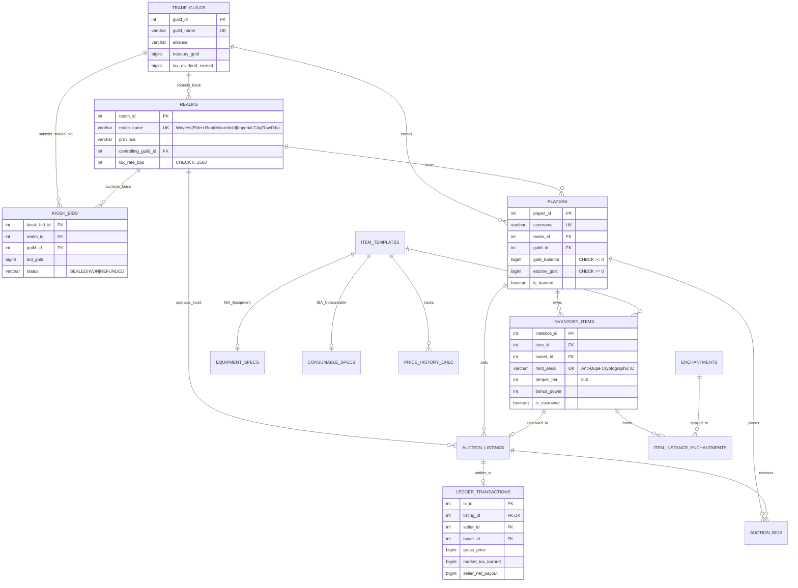

# Scrolls of Agora

**Tamriel Decentralized MMORPG Guild Exchange, Arcane Forge & Anti-Dupe Transaction Engine**

**Scrolls of Agora** is a high-concurrency relational marketplace, spatial guild-trader network, and double-entry financial ledger modeled after the decentralized economy of *The Elder Scrolls Online* and *World of Warcraft*.

Unlike standard e-commerce CRUD apps, **Scrolls of Agora** models a **decentralized 5-city economy** (**Wayrest**, **Elden Root**, **Mournhold**, **Imperial City**, and **Rawl'kha**) with no single global auction house—while solving the hardest backend engineering challenges in virtual game economies: **concurrent race-condition item duplication ("duping")**, **gold double-spending**, **multi-table atomic crafting**, **blind sealed-bid kiosk auctions**, and **recursive RMT money-laundering detection**.

---

## Signature Gameplay & Database Engineering Twists

### 1. Decentralized 5-City Tamriel Guild Kiosks & "The Weekly Flip"
* **Spatial Regional Orderbooks (`realms`, `trade_guilds`, `kiosk_bids`)**: Each of the 5 Tamriel trading hubs—**Wayrest** *(Stormhaven)*, **Elden Root** *(Grahtwood)*, **Mournhold** *(Deshaan)*, **Imperial City** *(Cyrodiil Warzone)*, and **Rawl'kha** *(Reaper's March)*—operates its own localized orderbook and basis-point tax rate (`tax_rate_bps`).
* **Tamriel Trade Centre (TTC) Arbitrage Radar**: Because prices vary by city, the orderbook runs a correlated subquery radar that highlights items listed significantly below another hub's floor price (e.g. buying *Dreugh Wax* in *Rawl'kha* at `19,500g` and flipping it in *Wayrest* at `34,500g` for `+77%` ROI).
* **Sealed-Bid Weekly Kiosk Auction (`resolve_weekly_kiosk_flip`)**: Trade Guilds submit blind treasury bids (`kiosk_bids`) to lease each city's kiosk. Triggering **The Weekly Kiosk Flip** executes an atomic SQL settlement that transfers kiosk control to the highest sealed bidder, automatically refunds all losing guilds' treasuries, and routes 50% of future city trade taxes to the winning syndicate.

### 2. Anti-Dupe Pessimistic Concurrency Control (`SELECT ... FOR UPDATE`)
* **The Race-Condition Exploit**: Under naive `READ COMMITTED` isolation without explicit row locks, if 100 threads attempt to buy out a 1-of-1 Mythic *Elder Scroll of Chim* at the exact same microsecond, all 100 read `status = 'ACTIVE'` before the first commit completes—cloning the item 100 times.
* **The Pessimistic Lock Defense**: `execute_atomic_buyout` acquires an exclusive row lock (`SELECT ... FOR UPDATE`) on `auction_listings` and locks buyer, seller, and outbid player wallets in **deterministic ascending `player_id` order** (`ORDER BY player_id ASC FOR UPDATE`) to guarantee **zero AB-BA deadlocks**. Thread #1 settles the trade; Threads #2–#100 wake up post-commit, observe `status = 'SOLD'`, and abort with **0 duplicated items**.

### 3. The Arcane Tempering Forge (Atomic Multi-Table Crafting Transaction)
* Selecting any unlocked Weapon, Armor, or Artifact in your **20-Slot Character Inventory Bag** lets you temper and enchant it at the **Arcane Forge** (`/api/temper-item`).
* In a single ACID transaction, the engine verifies wallet solvency, consumes *Dreugh Wax* or *Aetherial Chromium* stacks from `inventory_items`, increments `temper_tier` (`+1` to `+5`) and `bonus_power`, binds a new *Glyph* in `item_instance_enchantments`, and mints a new cryptographic `mint_serial` (`AGORA-TMPR...`).

### 4. Inquisitor `WITH RECURSIVE` RMT Gold-Laundering Graph Tracer
* Real-Money Trading (RMT) bot farms launder illicit gold by purchasing worthless `5g` common junk (*Cracked Goblinshiv*) across multi-hop mule chains for `300,000g+`.
* The **RMT Mule Graph** tab executes a **Recursive CTE (`WITH RECURSIVE`)** query across `ledger_transactions` to trace dirty gold hops (`Zul_Bot_Harvester -> Skooma_Launder_02 -> RMT_Syndicate_Boss`) and provides a 1-click **Atomic Inquisitor Seizure & Ban** that zeroes mule wallets and routes seized gold into legitimate Trade Guild treasuries.

---

## Entity-Relationship (ER) Architecture (12 Tables, BCNF / 3NF)



---

## Repository Structure

```text
Scrolls-of-Agora/
├── app.py                      # FastAPI dual-engine backend (PostgreSQL 18 pool + SQLite WAL fallback)
├── static/
│   └── index.html              # Interactive 5-city Tamriel map, 20-slot RPG bag, Arcane Forge & Dupe Lab UI
├── sql/
│   ├── schema.sql              # PostgreSQL 18 DDL (12 tables, ISA subtypes, kiosk bids & partial indexes)
│   ├── transactions.sql        # PL/pgSQL atomic buyout, escrow bid & Weekly Kiosk Flip procedures
│   ├── queries.sql             # 7 Relational Algebra (π, σ, ⋈, γ, −) & SQL analytical queries
│   └── seed.sql                # 5 Tamriel hubs, Trade Guilds, Mythic relics, glyphs & RMT mule chain
├── compose.yml                 # Docker Compose stack (PostgreSQL 18 + pgAdmin 4)
├── test_engine.py              # 13-point automated concurrency, crafting, kiosk flip & SQL test suite
└── README.md                   # Documentation
```

---

## Quick Start

### 1. Launch the Interactive Tamriel Market Workstation
```bash
pip install fastapi uvicorn pydantic "psycopg[binary,pool]"
python app.py
```
Open **[http://127.0.0.1:8090](http://127.0.0.1:8090)** in your browser:
* **Click Any of the 5 Tamriel City Nodes** (*Wayrest*, *Elden Root*, *Mournhold*, *Imperial City*, *Rawl'kha*) on the interactive map to filter that city's local Guild Kiosk orderbook and spot **TTC Cross-City Arbitrage** badges.
* **Temper & Enchant Gear in Your 20-Slot Bag**: Click any un-escrowed weapon or armor piece in your character's 5×4 inventory grid to either **Post it to a City Kiosk** or **Temper & Bind a Glyph** at the Arcane Forge (consumes *Dreugh Wax* from your bag and boosts item stats & value).
* **Trigger the Weekly Kiosk Flip**: Submit a blind treasury bid under **Guild Kiosk Bids** and click **Weekly Kiosk Flip** in the top bar to resolve kiosk leases across all 5 hubs.
* **Fire the 100-Thread Anti-Dupe Stress Lab**: Compare `SELECT ... FOR UPDATE` (`1 settled, 99 blocked, 0 dupes`) against an unprotected race condition across 100 concurrent threads.
* **Trace & Ban the RMT Mule Ring**: Open **RMT Mule Graph** to inspect the `WITH RECURSIVE` money-laundering chain and click **Ban Ring & Seize Gold**.

### 2. Run the 13-Point Automated Verification Suite
```bash
python test_engine.py
```

### 3. Run with Docker PostgreSQL 18 + pgAdmin 4
```bash
docker compose up -d
```
When the PostgreSQL 18 container is active on `localhost:5435`, `app.py` automatically detects it and upgrades its connection pool to `POSTGRESQL_18`.
