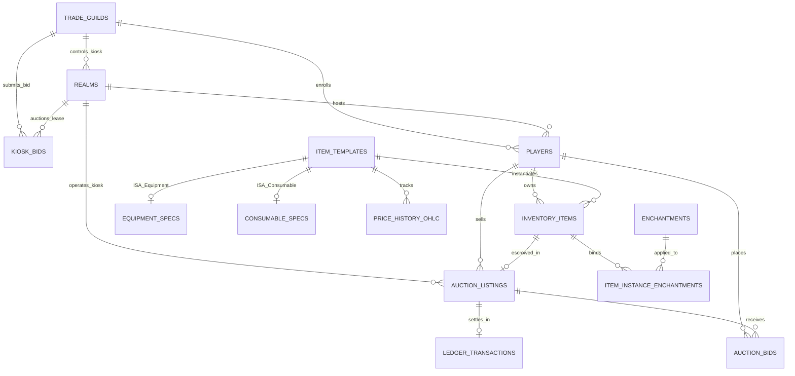

# Scrolls of Agora

**High-Throughput Partitioned Virtual Market Engine, Concurrency Control & Auditing in PostgreSQL / SQLite**  
*Academic Project for Relational Database Systems (IST DB1) & Systems Engineering Portfolios.*  
*Developer:* [Sebastian Paris (@sebiny12p)](https://github.com/sebiny12p)

---

## 1. Systems Architecture & Engineering Highlights

**Scrolls of Agora** is a relational transaction engine, multi-hub partitioned orderbook, and double-entry financial ledger modeled after the regional guild-trader economies of *The Elder Scrolls Online* and *World of Warcraft*.

Rather than a surface-level CRUD interface, this project addresses the core database systems challenges in transactional virtual economies:

1. **Pessimistic Concurrency Control (`SELECT ... FOR UPDATE` & 2PL):** Eliminates race-condition item duplication ("duping") and phantom double-spending across 100 simultaneous concurrent buyer connections using row-level tuple locks.
2. **Deadlock-Free Two-Phase Locking:** Enforces deterministic ascending primary key lock hierarchies (`ORDER BY player_id ASC FOR UPDATE`) to mathematically eliminate Coffman's circular wait condition (guaranteeing zero AB-BA deadlocks during multi-player transfers).
3. **Partitioned Regional Orderbooks:** Models 5 independent trading hubs (**Wayrest**, **Elden Root**, **Mournhold**, **Imperial City**, **Rawl'kha**) with localized tax rates, sealed-bid kiosk lease auctions, and cross-city floor-price arbitrage scanners.
4. **Formal Relational Normalization:** 12 tables decomposed into **Boyce-Codd Normal Form (BCNF)** and **Third Normal Form (3NF)** with ISA subtype specialization (`item_templates` $\to$ `equipment_specs` / `consumable_specs`), partial B-Tree covering indexes, and double-entry accounting balance constraints.
5. **Graph Query Traversal (`WITH RECURSIVE`):** Multi-hop cycle and wash-trade detection tracing illicit currency flows through Real-Money Trading (RMT) mule chains, coupled with dynamic account auditing.
6. **Dual-Engine Relational Abstraction:** Native support for both **PostgreSQL** (Docker Compose connection pool with PL/pgSQL procedures) and zero-config **SQLite 3** (Write-Ahead Logging with immediate 2PL serialization).

---

## 2. Technical Documentation & Reports

In-depth database design, relational algebra proofs, and concurrency analyses are available in the [`docs/`](docs/) directory:

* 📐 **[Normalization & Dependency Analysis (`docs/NORMALIZATION.md`)](docs/NORMALIZATION.md)**  
  Candidate keys, minimal functional dependency covers ($F_{min}$), 1NF $\to$ 2NF $\to$ 3NF $\to$ BCNF proofs, lossless-join decompositions, and controlled denormalization justifications.
* 🔒 **[Concurrency Control & Deadlock Prevention (`docs/CONCURRENCY.md`)](docs/CONCURRENCY.md)**  
  Deep dive into MVCC snapshot isolation anomalies, row-level tuple locks (`ExclusiveLock`), Coffman condition breakdown, and sequence diagrams of multi-threaded race conditions.
* ⚡ **[Query Plans & Performance Benchmarks (`docs/BENCHMARKS.md`)](docs/BENCHMARKS.md)**  
  `EXPLAIN (ANALYZE, BUFFERS)` execution plan breakdowns, partial index evaluation, 10,000+ row scaling benchmarks, and concurrency throughput metrics.

---

## 3. Entity-Relationship (ER) Architecture (12 Relations)



---

## 4. Relational Algebra ($\pi, \sigma, \bowtie, \gamma, \div, -$) & Query Suite

The engine provides 7 operational and analytical queries with formal relational algebra notations implemented in [`sql/queries.sql`](sql/queries.sql):

| Query | Relational Operations | Natural Language Purpose |
| :--- | :--- | :--- |
| **Q1** | $\pi, \sigma$ | Filter high-tier Mythic/Legendary items requiring level 60+ ordered by base vendor value. |
| **Q2** | $\bowtie$ | 5-Table ISA subtype join retrieving active equipment with combat stats, seller name, and buyout price. |
| **Q3** | $-$ | Universal set difference (`NOT EXISTS`) finding rare/mythic items with zero active kiosk listings. |
| **Q4** | $\gamma$ | Grouping and multi-table aggregation computing gross trading volume and tax burn per regional hub. |
| **Q5** | $\bowtie_{self}, \sigma$ | Self-join on floor price CTE highlighting cross-hub arbitrage spreads with $>15\%$ ROI. |
| **Q6** | $\bowtie_\theta$ | Non-equi theta join flagging RMT wash-trading transactions ($>15\times$ base vendor value). |
| **Q7** | Window ($RANK$) | Window function ranking merchant whales by liquid + escrow gold within their alliance faction. |

---

## 5. Repository Structure

```text
Scrolls-of-Agora/
├── src/
│   ├── config.py                 # Typed configuration & environment loading
│   ├── database.py               # Dual-engine adapter (PostgreSQL connection pool + SQLite WAL)
│   ├── models.py                 # Pydantic schemas (typed request/response validation)
│   ├── repositories/             # Data Access Objects (parameterized SQL)
│   │   ├── market_repo.py        # Orderbook, inventory bag & 24h candlestick queries
│   │   ├── transaction_repo.py   # Atomic buyout, escrow bidding, forging & kiosk flip
│   │   └── analytics_repo.py     # 7 Relational queries, query plans & recursive CTE
│   ├── services/
│   │   └── dupe_bench_service.py # Real multi-threaded database concurrency benchmark
│   └── routers/                  # Modular FastAPI APIRouters
│       ├── market.py
│       ├── transactions.py
│       ├── analytics.py
│       └── benchmarks.py
├── sql/
│   ├── schema.sql                # PostgreSQL master DDL (constraints & partial indexes)
│   ├── seed.sql                  # PostgreSQL seed dataset
│   ├── schema_sqlite.sql         # SQLite WAL DDL
│   ├── seed_sqlite.sql           # SQLite WAL seed dataset
│   ├── queries.sql               # Relational algebra query suite
│   ├── transactions.sql          # PL/pgSQL stored procedures (FOR UPDATE)
│   └── explain_plans.sql         # EXPLAIN (ANALYZE, BUFFERS) query plans
├── scripts/
│   └── seed_scale.py             # 10,000+ tuple dataset generator & index evaluator
├── static/
│   ├── index.html                # Telemetry & Exchange Console
│   ├── css/style.css             # Modular responsive stylesheet
│   └── js/app.js                 # UI orchestrator, query plan inspector & canvas charts
├── docs/
│   ├── NORMALIZATION.md          # Functional dependencies & 3NF/BCNF proofs
│   ├── CONCURRENCY.md            # 2PL, MVCC, lock ordering & deadlock elimination
│   └── BENCHMARKS.md             # Concurrency test results & query plan analysis
├── app.py                         # Clean FastAPI application entry point
├── test_engine.py                 # 13-point automated verification & concurrency suite
└── compose.yml                    # Docker Compose stack (PostgreSQL 17-alpine + pgAdmin 4)
```

---

## 6. Quick Start & Execution

### 1. Launch the Server (Zero-Config SQLite WAL)
```bash
pip install fastapi uvicorn pydantic "psycopg[binary,pool]"
python app.py
```
Open **[http://127.0.0.1:8090](http://127.0.0.1:8090)** in your browser:
* **Interactive 5-Hub Regional Map**: Inspect local kiosk orders and spot cross-city arbitrage opportunities.
* **Character Bag & Arcane Forge**: Click un-escrowed gear to list it on a regional kiosk or temper it with crafting resins.
* **Weekly Kiosk Flip**: Resolve sealed blind bids across all 5 hubs and refund losing guild treasuries atomically.
* **100-Thread Anti-Dupe Lab**: Benchmark real `SELECT ... FOR UPDATE` serialization against unprotected concurrent reads.
* **Relational Query & Plan Inspector**: Inspect mathematical Relational Algebra notations alongside real `EXPLAIN QUERY PLAN` optimizer trees.

### 2. Run the Automated Verification Suite
```bash
python test_engine.py
```
Validates:
* 5-Hub state integrity (12 active orders, 21 unique serials)
* Atomic escrow bids and outbid automatic refunds
* Multi-table Arcane Forge crafting transaction
* Sealed guild kiosk bidding and weekly flip resolution
* Recursive CTE RMT money-laundering detection and dynamic account auditing
* Real multi-threaded unprotected race benchmark (detects phantom purchases on concurrent connections)
* 100-thread pessimistic locking stress test (guarantees exactly 1 winner, 0 dupes)
* All 7 relational algebra analytical queries

### 3. Generate Large-Scale Data & Benchmark Partial Indexes (10,000+ Rows)
```bash
python scripts/seed_scale.py --listings 10000 --players 2000
```
Populates a realistic skewed distribution (5% active listings, 95% historical closed listings) and evaluates query execution plans against partial B-Tree indexes.

### 4. Run with PostgreSQL 17 in Docker
```bash
docker compose up -d
python app.py
```
The application detects the PostgreSQL connection pool on port `5435` and switches `ACTIVE_BACKEND` to `POSTGRESQL`.

---

## 7. License
MIT License. Built for educational and portfolio demonstration.
