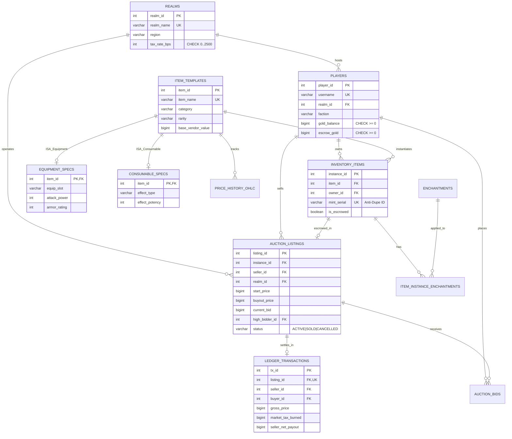

# Scrolls of Agora

**Decentralized MMORPG Guild Exchange, Orderbook & Anti-Dupe Transaction Engine**

**Scrolls of Agora** is a high-concurrency relational marketplace, orderbook, and double-entry financial ledger inspired by the decentralized Guild Trader economy of *The Elder Scrolls Online* and *World of Warcraft*. It is engineered from the ground up to solve the two hardest backend problems in virtual game economies: **concurrent race-condition item duplication ("duping")** and **gold double-spending** under high-contention load.

Built with **PostgreSQL 18**, **FastAPI**, and a custom zero-dependency **RPG Market Workstation UI** featuring vector item inspection, a 20-slot interactive character inventory bag, real-time 24h OHLCV candlestick telemetry, and a 100-thread hardware-barrier concurrency stress lab.

---

## Core Systems & Database Engineering

### 1. Anti-Dupe Pessimistic Concurrency Control (`SELECT ... FOR UPDATE`)
In a naive `READ COMMITTED` transaction without explicit row locks, if 100 players or bots attempt to buy out the same 1-of-1 Mythic relic within the same millisecond window, all 100 transactions read `status = 'ACTIVE'` before the first commit completes—cloning the item 100 times or corrupting wallet balances.

**Scrolls of Agora** prevents this at the storage-engine level:
* Acquires an exclusive pessimistic row lock (`SELECT ... FOR UPDATE`) on the target `auction_listings` record before evaluating state.
* Locks the buyer, seller, and previous high-bidder rows in **deterministic ascending `player_id` order** (`ORDER BY player_id ASC FOR UPDATE`), mathematically eliminating circular wait conditions and **AB-BA deadlocks**.
* Serializes competing threads at the lock boundary: Thread #1 transitions `status -> 'SOLD'` and transfers the unique cryptographic `mint_serial`; Threads #2–#100 wake up post-commit, observe the mutated state, and abort in microseconds with **0 duplicated items**.

### 2. Escrow Bidding & Deflationary Gold-Sink Double-Entry Ledger
* **Atomic Escrow State Machine**: Placing a bid atomically locks liquid `gold_balance` into `escrow_gold` and refunds the prior high bidder's escrow within the same ACID transaction.
* **Conservation of Value Invariant**: Every settled trade writes an immutable record to `ledger_transactions` governed by a strict database constraint:
  ```sql
  CONSTRAINT chk_ledger_math CHECK (gross_price = market_tax_burned + seller_net_payout)
  ```
* **Regional Kiosk Tax Sinks**: Each trading hub (*Mournhold-Grand-Kiosk*, *Vivec-Canton-Exchange*, *Wayrest-Royal-Bazaar*) enforces basis-point tax burns (`tax_rate_bps`) that permanently remove gold from circulation to combat MMO hyperinflation.

### 3. 10-Table Normalized Schema (BCNF / 3NF) with ISA Subtype Specialization
* **ISA Generalization Hierarchy**: Models `item_templates` as the supertype entity with disjoint specialization subtypes `equipment_specs` (weapons/armor combat stats, durability, sockets) and `consumable_specs` (alchemical buffs, potency, duration, cooldowns).
* **Cryptographic Mint Serials & Partial Indexing**: Every physical item in `inventory_items` carries a unique `mint_serial` (`AGORA-...`) and a partial uniqueness index (`WHERE status = 'ACTIVE'`) ensuring an item instance can never be double-listed.

### 4. Built-in Analytical SQL, Arbitrage & Anti-Cheat RMT Engine
Includes 7 live analytical queries paired with formal Relational Algebra ($\pi, \sigma, \bowtie, \gamma, -$) and live `EXPLAIN QUERY PLAN` profiling:
* **Cross-Hub Arbitrage Scanner (`Q5`)**: Self-joins active floor prices across trading hubs to surface instant $>15\%$ ROI spreads.
* **RMT Gold-Laundering Wash-Trade Detector (`Q6`)**: Flags illicit Real-Money Trading mules buying common grey junk items at $>15\times$ base valuation.
* **Market Scarcity Set-Difference Finder (`Q3`)**: Uses relational set difference ($-$ / `NOT EXISTS`) to detect high-tier items experiencing complete supply droughts.

---

## Entity-Relationship (ER) Architecture



---

## Repository Structure

```text
Scrolls-of-Agora/
├── app.py                      # FastAPI high-concurrency trading server & barrier stress-test engine
├── static/
│   └── index.html              # RPG market workstation UI, 20-slot inventory bag & 24h OHLCV canvas chart
├── sql/
│   ├── schema.sql              # PostgreSQL 18 DDL, CHECK constraints, ISA subtypes & partial indexes
│   ├── transactions.sql        # PL/pgSQL atomic buyout & escrow bid stored functions (SELECT ... FOR UPDATE)
│   ├── queries.sql             # 7 Relational Algebra (π, σ, ⋈, γ, −) & SQL analytical queries
│   └── seed.sql                # Initial trading hubs, merchants, Mythic relics, glyphs & historical ledger
├── compose.yml                 # Docker Compose stack (PostgreSQL 18 + pgAdmin 4)
├── test_engine.py              # Automated concurrency & relational integrity verification suite
└── README.md                   # Documentation
```

---

## Quick Start

### 1. Run the Interactive RPG Market Workstation (Zero-Config)
Runs out of the box with Python and FastAPI:

```bash
pip install fastapi uvicorn pydantic
python app.py
```

Open **[http://127.0.0.1:8090](http://127.0.0.1:8090)** in your browser:
* **Inspect & Trade**: Hover over any item icon for its RPG combat/alchemy tooltip, click rows to inspect 24h OHLCV candlestick price action, or execute instant atomic buyouts and escrow bids.
* **20-Slot Character Inventory Bag**: Switch active merchant characters, inspect your 5×4 inventory grid, and click any unlocked item in your bag to list it directly onto the active orderbook.
* **100-Thread Anti-Dupe Stress Lab**: Fire 100 barrier-synchronized threads at a single 1-of-1 Mythic relic (`Elder Scroll of Chim`) and compare **Pessimistic Row Locking (`1 settled, 99 blocked, 0 dupes`)** against an **Unlocked Race Condition**.
* **Autonomous Market Bots**: Toggle `Auto-Sim: LIVE` to watch autonomous merchant bots list items, outbid each other, and settle trades in real time.

### 2. Run the Automated Verification Suite
```bash
python test_engine.py
```

### 3. Run the PostgreSQL 18 + pgAdmin 4 Docker Stack
```bash
docker compose up -d
```
* **PostgreSQL 18**: `localhost:5435` (`user: agora`, `db: scrolls_of_agora`)
* **pgAdmin 4**: `http://localhost:5055`
