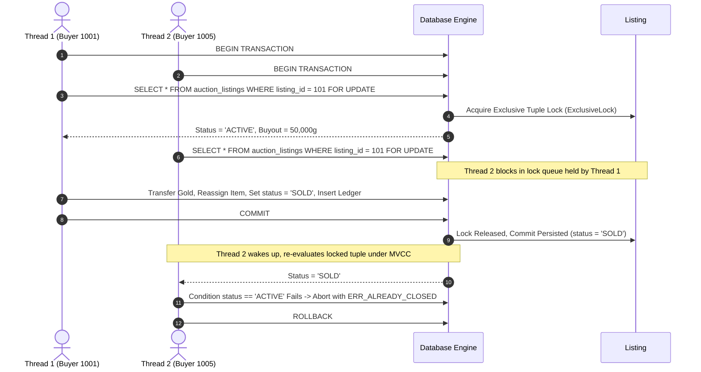
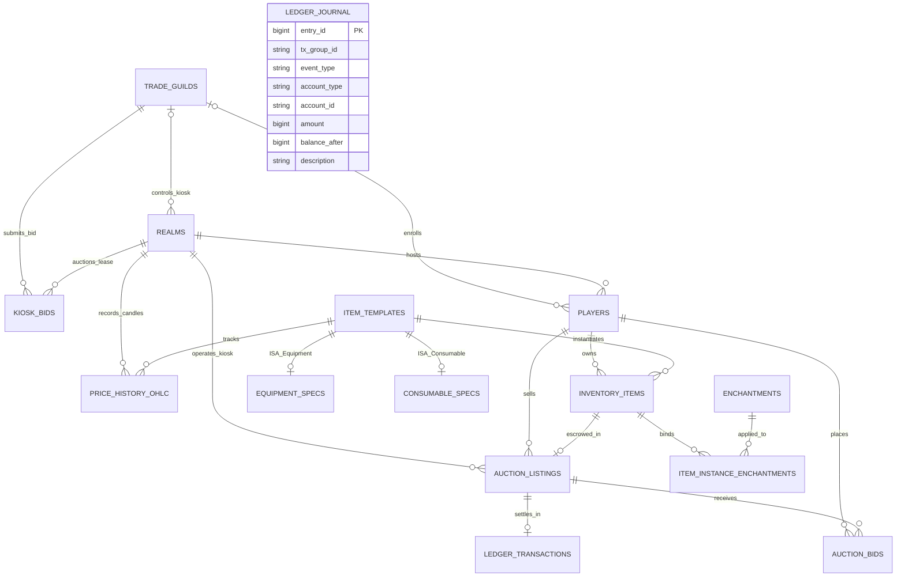

# Scrolls of Agora

**High-Throughput Partitioned Virtual Market Engine, Concurrency Control & Double-Entry Auditing in PostgreSQL / SQLite**  
*Systems Engineering Portfolio & Relational Database Systems Project.*  
*Developer:* [Sebastian Paris (@sebiny12p)](https://github.com/sebiny12p)

---

## 1. Overview & Systems Architecture

Virtual economies—such as those in *The Elder Scrolls Online*, *World of Warcraft*, and *EVE Online*—present unique relational database challenges: localized regional market hubs, high-velocity orderbooks, and the catastrophic risk of race-condition asset duplication ("duping").

**Scrolls of Agora** is a relational transaction engine, multi-hub partitioned orderbook, and double-entry financial ledger engineered to maintain strict mathematical and transactional consistency under high-concurrency contention:

1. **Pessimistic Concurrency Control (`SELECT ... FOR UPDATE` & 2PL):** Eliminates race-condition item duplication ("duping") and double-spending across 100 simultaneous concurrent buyer connections using row-level tuple locks.
2. **Deadlock-Free Two-Phase Locking:** Enforces deterministic ascending primary key lock hierarchies (`ORDER BY player_id ASC FOR UPDATE`) across both PL/pgSQL stored procedures and Python repositories to eliminate Coffman's circular wait condition.
3. **Partitioned Regional Orderbooks:** Models 5 independent trading hubs (**Wayrest**, **Elden Root**, **Mournhold**, **Imperial City**, **Rawl'kha**) with localized tax rates, sealed-bid kiosk lease auctions, and cross-city floor-price arbitrage scanners.
4. **True Double-Entry General Ledger:** Implements balanced journal entries (`ledger_journal`) across `PLAYER_LIQUID`, `PLAYER_ESCROW`, `GUILD_TREASURY`, and `SYSTEM_SINK` accounts, enforcing the strict mathematical invariance $\sum \text{amount} = 0$ across all transaction groups (buyouts, escrow locks, outbid refunds, forge fees, and kiosk leases).
5. **Cycle-Safe Recursive CTE Graph Traversal (`WITH RECURSIVE`):** Multi-hop cycle and wash-trade detection tracing illicit currency flows through Real-Money Trading (RMT) mule chains, guarded against infinite recursion via SQL-level path-traversal tracking.
6. **Formal Relational Normalization:** 15 tables decomposed into **Boyce-Codd Normal Form (BCNF)** and **Third Normal Form (3NF)** with ISA subtype specialization (`item_templates` $\to$ `equipment_specs` / `consumable_specs`) and partial B-Tree covering indexes.
7. **Dual-Engine Relational Abstraction:** Native support for both **PostgreSQL** (Docker Compose connection pool with PL/pgSQL procedures) and zero-config **SQLite 3** (Write-Ahead Logging with immediate 2PL serialization).

---

## 2. Concurrency Control & Anti-Dupe Serialization

In naive database implementations, concurrent buyers competing for a unique 1-of-1 asset read an uncommitted snapshot before the seller's state transition commits, causing dirty reads, write collisions, or duplicate asset minting. 

*Scrolls of Agora* serializes concurrent contenders at the tuple level using pessimistic row locks:



### Empirical Stress Benchmark (100 Concurrent Threads)
The engine includes a multi-threaded stress testing lab (`src/services/dupe_bench_service.py`):

```text
========================================================================
  CONCURRENCY STRESS LAB: 100 THREADS RACING FOR 1 MYTHIC ITEM
========================================================================
[UNPROTECTED READ-MODIFY-WRITE]
* Protocol:                Uncoordinated SELECT -> UPDATE status = 'SOLD'
* Threads in Race Window:  11 concurrent workers read stale snapshot
* Write Collisions:        10 dirty write collisions detected
* Result:                  CRITICAL DATA CORRUPTION / DUPLICATE ITEM MINTED

[PESSIMISTIC TWO-PHASE LOCKING (SELECT ... FOR UPDATE)]
* Protocol:                Row-level tuple lock (ExclusiveLock) + immediate serialization
* Threads Processed:       100 concurrent workers
* Settled Winners:         1 (Exactly 1 transaction committed)
* Blocked by Lock Queue:   99 cleanly aborted (ERR_ALREADY_CLOSED)
* Duplicate Items Minted:  0 (Absolute physical entity preservation)
* Status:                  100% ACID TRANSACTIONAL ISOLATION
========================================================================
```

---

## 3. Technical Documentation & Reports

In-depth database design, relational algebra proofs, and concurrency analyses are available in the [`docs/`](docs/) directory:

* 📐 **[Normalization & Dependency Analysis (`docs/NORMALIZATION.md`)](docs/NORMALIZATION.md)**  
  Candidate keys, minimal functional dependency covers ($F_{min}$), 1NF $\to$ 2NF $\to$ 3NF $\to$ BCNF proofs, lossless-join decompositions, and controlled denormalization justifications.
* 🔒 **[Concurrency Control & Deadlock Prevention (`docs/CONCURRENCY.md`)](docs/CONCURRENCY.md)**  
  Deep dive into MVCC snapshot isolation anomalies, row-level tuple locks (`ExclusiveLock`), Coffman condition breakdown, and sequence diagrams of multi-threaded race conditions.
* ⚡ **[Query Plans & Performance Benchmarks (`docs/BENCHMARKS.md`)](docs/BENCHMARKS.md)**  
  `EXPLAIN (ANALYZE, BUFFERS)` execution plan breakdowns, partial index evaluation, 10,000+ row scaling benchmarks, and concurrency throughput metrics.

---

## 4. Entity-Relationship (ER) Architecture (15 Relations)



> **Note on General Ledger Architecture:** `ledger_journal` is an append-only double-entry ledger enforcing zero-sum invariance ($\sum \text{amount} = 0$). It connects polymorphically across `PLAYER_LIQUID`, `PLAYER_ESCROW`, `GUILD_TREASURY`, and `SYSTEM_SINK` accounts via `account_type` and `account_id` rather than a single static foreign key.

---

## 5. Relational Algebra ($\pi, \sigma, \bowtie, \gamma, \div, -$) & Query Suite

The engine provides 7 operational and analytical queries with formal relational algebra notations implemented in [`sql/queries.sql`](sql/queries.sql):

| Query | Relational Operations | Natural Language Purpose |
| :--- | :--- | :--- |
| **Q1** | $\pi, \sigma$ | Filter high-tier Mythic/Legendary items requiring level 60+ ordered by base vendor value. |
| **Q2** | $\bowtie$ | 5-Table ISA subtype join retrieving active equipment with combat stats, seller name, and buyout price. |
| **Q3** | $-$ | Universal set difference (`NOT EXISTS`) finding rare/mythic items with zero active kiosk listings. |
| **Q4** | $\gamma$ | Grouping and multi-table aggregation computing gross trading volume and tax burn per regional hub. |
| **Q5** | $\bowtie_{self}, \sigma$ | Self-join on floor price CTE highlighting cross-hub arbitrage spreads with $>25\%$ profit margin. |
| **Q6** | $\bowtie_\theta$ | Non-equi theta join flagging anomalous transactions ($>10\times$ vendor value or $>2.5\times$ market average). |
| **Q7** | Window ($RANK$) | Window function ranking merchant whales by liquid + escrow gold within their alliance faction. |

---

## 6. Repository Structure

```text
Scrolls-of-Agora/
├── src/
│   ├── config.py                 # Typed configuration, domain constants & environment loading
│   ├── database.py               # Multi-engine adapter (PostgreSQL pool + SQLite WAL) & double-entry journal
│   ├── models.py                 # Pydantic schemas (typed request/response validation)
│   ├── repositories/             # Data Access Objects (parameterized SQL)
│   │   ├── market_repo.py        # Orderbook, inventory bag & 24h candlestick queries
│   │   ├── transaction_repo.py   # Atomic buyout, escrow bidding, forging, kiosk flip & balanced journal
│   │   └── analytics_repo.py     # 7 Relational queries, query plans & cycle-safe recursive CTE
│   ├── services/
│   │   └── dupe_bench_service.py # Multi-threaded database concurrency benchmark (Pessimistic vs Unsafe)
│   └── routers/                  # Modular FastAPI APIRouters
│       ├── market.py
│       ├── transactions.py
│       ├── analytics.py
│       └── benchmarks.py
├── sql/
│   ├── schema.sql                # PostgreSQL master DDL (constraints & partial indexes)
│   ├── seed.sql                  # PostgreSQL seed dataset
│   ├── schema_sqlite.sql         # SQLite WAL DDL
│   ├── seed_sqlite.sql           # SQLite WAL seed dataset
│   ├── queries.sql               # Relational algebra query suite
│   ├── transactions.sql          # PL/pgSQL stored procedures (FOR UPDATE)
│   └── explain_plans.sql         # EXPLAIN (ANALYZE, BUFFERS) query plans
├── tests/                        # Comprehensive Pytest Suite
│   ├── conftest.py               # Test isolation fixtures
│   ├── test_database.py          # Adapter, dialect adaptation & telemetry tests
│   ├── test_transactions.py      # Buyouts, escrow, forging, kiosk flips & journal invariance
│   ├── test_analytics.py         # Relational queries & cycle-safe CTE
│   └── test_concurrency.py       # Multi-threaded concurrency benchmarks
├── scripts/
│   └── seed_scale.py             # 10,000+ tuple dataset generator & index evaluator
├── static/
│   ├── index.html                # Telemetry & Exchange Console
│   ├── css/style.css             # Modular responsive stylesheet
│   └── js/app.js                 # UI orchestrator, query plan inspector & canvas charts
├── docs/
│   ├── NORMALIZATION.md          # Functional dependencies & 3NF/BCNF proofs
│   ├── CONCURRENCY.md            # 2PL, MVCC, lock ordering & deadlock elimination
│   └── BENCHMARKS.md             # Concurrency test results & query plan analysis
├── app.py                         # Clean FastAPI application entry point
├── test_engine.py                 # 14-point systems verification & concurrency suite
└── compose.yml                    # Docker Compose stack (PostgreSQL 17-alpine + pgAdmin 4)
```

---

## 7. Quick Start & Execution

### 1. Launch the Server (Zero-Config SQLite WAL)
```bash
pip install fastapi uvicorn pydantic "psycopg[binary,pool]" pytest
python app.py
```
Open **[http://127.0.0.1:8090](http://127.0.0.1:8090)** in your browser:
* **Interactive 5-Hub Regional Map**: Inspect local kiosk orders and spot cross-city arbitrage opportunities.
* **Character Bag & Arcane Forge**: Click un-escrowed gear to list it on a regional kiosk or temper it with crafting resins.
* **Weekly Kiosk Flip**: Resolve sealed blind bids across all 5 hubs and refund losing guild treasuries atomically.
* **100-Thread Anti-Dupe Lab**: Benchmark real `SELECT ... FOR UPDATE` serialization against unprotected concurrent reads.
* **Relational Query & Plan Inspector**: Inspect mathematical Relational Algebra notations alongside real `EXPLAIN QUERY PLAN` optimizer trees.
* **Double-Entry General Ledger**: Verify zero-imbalance balance sheets across the entire economy.

### 2. Run the Automated Test Suites

**Run the Pytest Suite (19 tests):**
```bash
pytest tests/ -v
```

**Run the 14-Point Systems Verification Runner:**
```bash
python test_engine.py
```
Output:
```text
========================================================================
  SCROLLS OF AGORA (v3.1) — SYSTEMS RELATIONAL & CONCURRENCY SUITE
========================================================================
[PASS] 5 Tamriel Hubs Verified: Wayrest, Elden Root, Mournhold, Imperial City, Rawl'kha
[PASS] Atomic Escrow Bid & Outbid Refund Verified: Escrow locked, prior bidder refunded
[PASS] Arcane Tempering Forge Verified: Tempered item, bound glyph, consumed crafting resins
[PASS] Sealed Guild Kiosk Bid & Weekly Flip Verified: Resolved leases & refunded losing syndicates
[PASS] Recursive CTE RMT Tracer & Inquisitor Seizure: Banned wash ring & seized illicit gold
[PASS] Unprotected Race Benchmark: Detected concurrent stale-read race window & write collisions
[PASS] 100-Thread Anti-Dupe Stress Test: 1 settled, 99 blocked by lock queue, 0 dupes minted
[PASS] Q1–Q7 Relational Algebra Operational & Analytical Queries: 100% verified
[PASS] Double-Entry Ledger Invariance Verified: 0 imbalance (Credits + Debits = 0)
========================================================================
  ALL 14 SYSTEMS VERIFICATION & CONCURRENCY CHECKS PASSED 100%!
========================================================================
```

### 3. Generate Large-Scale Data & Benchmark Partial Indexes (10,000+ Rows)
```bash
python scripts/seed_scale.py --listings 10000 --players 2000
```
Populates a realistic skewed distribution (5% active listings, 95% historical closed listings) and evaluates query execution plans against partial B-Tree indexes.

### 4. Run with PostgreSQL 17 in Docker
```bash
docker compose up -d
python app.py
```
The application detects the PostgreSQL connection pool on port `5435` and switches `ACTIVE_BACKEND` to `POSTGRESQL`.

---

## 8. License
MIT License. Built for educational and portfolio demonstration.
