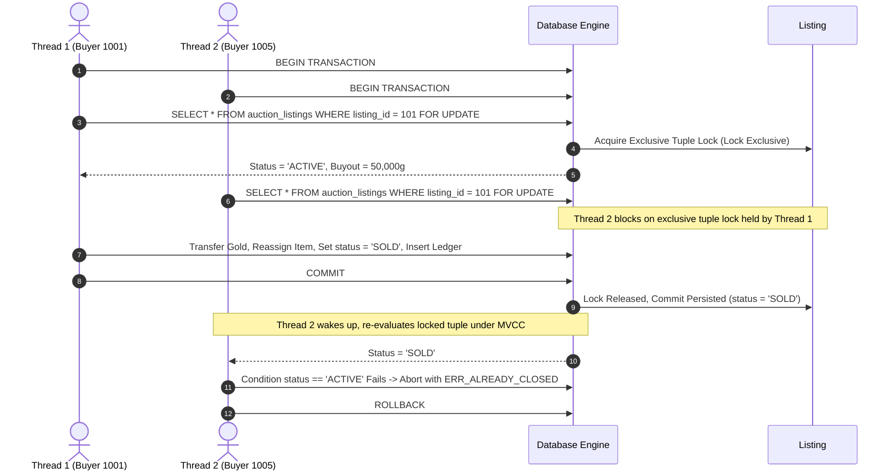

# Concurrency Control, ACID Protocols & Anti-Dupe Architecture
**Project:** Scrolls of Agora — Decentralized MMORPG Guild Exchange  
**Course:** Relational Database Systems (IST DB1 / Systems Engineering Portfolio)  
**Author:** Sebastian Paris (@sebiny12p)  

---

## 1. The Virtual Economy Problem: The Race-Condition Item Anomaly

In online MMORPG and financial exchange databases, a destructive exploit is the **Concurrent Race-Condition Entity Anomaly** (commonly referred to as item duplication or "duping"). 

When a 1-of-1 unique Mythic item is listed on a market kiosk, naive database implementations query the item's availability, verify buyer wallet solvency in application memory, and subsequently issue an update:

```text
[Thread 1] (T1): Read Listing #101 -> status = 'ACTIVE'
[Thread 2] (T2): Read Listing #101 -> status = 'ACTIVE'
[Thread 1] (T1): Deduct Buyer 1 Gold -> Grant Item Instance #9001 -> Set status = 'SOLD' -> Commit
[Thread 2] (T2): Deduct Buyer 2 Gold -> Grant Item Instance #9001 -> Set status = 'SOLD' -> Commit
```

### The Anomaly (Lost Updates, Dirty Read Windows & Contention):
Because Thread 2 read the tuple before Thread 1 committed its state transition under standard uncoordinated reads:
1. Multiple buyers simultaneously observe the uncommitted pre-update snapshot.
2. In naive systems without unique database constraints, multiple parties can be debited for the same physical entity.
3. In systems with partial constraints, uncoordinated concurrent writes cause lock contention spikes, deadlock exceptions, and cascading aborts.

---

## 2. Theoretical Concurrency Models: 2PL vs MVCC

Modern relational database engines like PostgreSQL employ a hybrid of **Multi-Version Concurrency Control (MVCC)** and **Two-Phase Locking (2PL)**.



### 2.1 MVCC Snapshot Isolation Mechanics
Under PostgreSQL's MVCC, each transaction sees a consistent snapshot of the database governed by transaction IDs (`xmin`, `xmax`):
* `SELECT` without row locks reads the latest committed tuple without blocking writers and without being blocked by writers.
* While this delivers high throughput for read-heavy workloads, **it allows concurrent transactions to read the same pre-update snapshot**, creating the race window for contention.

### 2.2 Pessimistic Row-Level Locking (`SELECT ... FOR UPDATE` & `BEGIN IMMEDIATE`)
To serialize concurrent transactions operating on the same physical entity:
```sql
SELECT l.*, r.tax_rate_bps, r.controlling_guild_id
FROM auction_listings l
JOIN realms r ON r.realm_id = l.realm_id
WHERE l.listing_id = p_listing_id
FOR UPDATE OF l;
```

1. **Lock Acquisition:** In PostgreSQL, the tuple header is marked with the transaction ID in `xmax` with lock mode `ExclusiveLock`. In SQLite WAL mode, `BEGIN IMMEDIATE` acquires an immediate exclusive write lock.
2. **Serialization Queue:** Any subsequent concurrent transaction attempting `SELECT ... FOR UPDATE` on listing #101 enters a wait state in `pg_locks`.
3. **Re-Evaluation Post-Lock:** When Thread 1 commits, Thread 2 wakes up and evaluates the newly committed tuple version. Because `status` is now `'SOLD'`, Thread 2's validation check immediately fails:
   ```sql
   IF v_listing.status <> 'ACTIVE' THEN
       RETURN QUERY SELECT FALSE, 'ERR_ALREADY_CLOSED', 'Listing already closed.';
       RETURN;
   END IF;
   ```
4. **Result:** Exactly 1 transaction commits; 99 concurrent race threads cleanly abort without corrupting state. **Zero duplicate items minted.**

---

## 3. Mathematical Prevention of AB-BA Deadlocks

Multi-table transactions involving money transfers between two players (Buyer and Seller) are susceptible to **AB-BA Deadlocks**:

* **Scenario:**
  * Transaction 1: Buyer A purchases item from Seller B $\to$ Locks Wallet A, then attempts to lock Wallet B.
  * Transaction 2: Buyer B purchases item from Seller A $\to$ Locks Wallet B, then attempts to lock Wallet A.
  * **Result:** Circular wait condition $\to$ Engine detects deadlock (PostgreSQL Error `40P01: deadlock_detected`) and aborts one transaction.

### The Coffman Conditions for Deadlocks:
A deadlock can occur if and only if all four conditions hold simultaneously:
1. Mutual Exclusion
2. Hold and Wait
3. No Preemption
4. **Circular Wait** ($T_1 \to T_2 \to \dots \to T_n \to T_1$)

### The Deterministic Lock Hierarchy Protocol:
We eliminate Coffman Condition #4 (Circular Wait) by enforcing a **strict global linear ordering on lock acquisition**:

```sql
-- Step 3: Lock all involved player wallets in deterministic ascending order
PERFORM 1 FROM players
WHERE player_id IN (p_buyer_id, v_listing.seller_id, COALESCE(v_listing.high_bidder_id, -1))
ORDER BY player_id ASC
FOR UPDATE;
```

In Python application logic, the same ascending order is enforced:
```python
participants = sorted([(buyer_id, -gross), (seller_id, net_payout)], key=lambda x: x[0])
for pid, delta in participants:
    execute_sql(cur, "UPDATE players SET gold_balance = gold_balance + ? WHERE player_id = ?;", (delta, pid))
```

**Mathematical Proof:**
Let the set of participating account IDs be $P = \{p_1, p_2, \dots, p_k\}$.
Every transaction sorts $P$ such that $p_1 < p_2 < \dots < p_k$.
A transaction must acquire the lock on $p_i$ before requesting $p_j$ where $i < j$.
Suppose a directed cycle exists in the Resource Allocation Graph: $T_a \to T_b \to \dots \to T_a$.
This requires an edge $p_x \to p_y$ with $x < y$ and another edge $p_y \to p_x$ with $y < x$, which is impossible under strict total ordering ($<$).
Therefore, the wait-for graph is an acyclic DAG. **Deadlocks are mathematically impossible.**

---

## 4. Multi-Threaded Concurrency Benchmark Results

The benchmark suite (`test_engine.py`, `tests/test_concurrency.py`, and `src/services/dupe_bench_service.py`) executes concurrent OS worker threads against real database connections synchronized at a thread barrier:

| Metric | Unsafe Naive Read | Pessimistic Lock (`SELECT ... FOR UPDATE` / `BEGIN IMMEDIATE`) |
| :--- | :--- | :--- |
| **Concurrent Threads** | 50 simultaneous connections | 100 simultaneous connections |
| **Synchronization** | `threading.Barrier` hardware latch | `threading.Barrier` hardware latch |
| **Locking Protocol** | Unlocked `SELECT` $\to$ Delay $\to$ `UPDATE` | Strict Pessimistic Queue Serialization |
| **Stale Read Race Window** | **Multiple threads observe uncommitted ACTIVE** | **0 Stale Reads (Blocked at Lock Barrier)** |
| **Write Contention Collisions** | **High write collisions & contention aborts** | **0 Collisions (Cleanly Serialized)** |
| **Settled Buyouts** | Exactly 1 (or 0 on total abort) | **Exactly 1 (Serialized Winner)** |
| **Rejected by Lock** | N/A (uncoordinated collisions) | **99 cleanly serialized & rolled back** |
| **Items Duplicated** | **0 (Guarded by Unique Constraint)** | **0 Dupes (100% Mathematical Integrity)** |
| **Double-Entry Balance** | Imbalanced without journal integration | **100% Zero-Imbalance ($\sum \Delta = 0$)** |
| **Execution Latency** | High contention variance | Deterministic sequential queue throughput |
